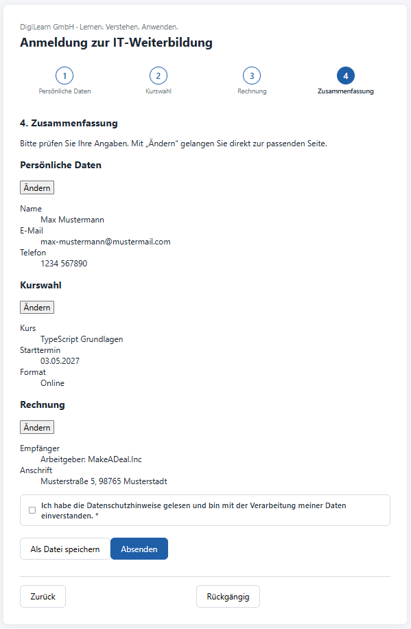
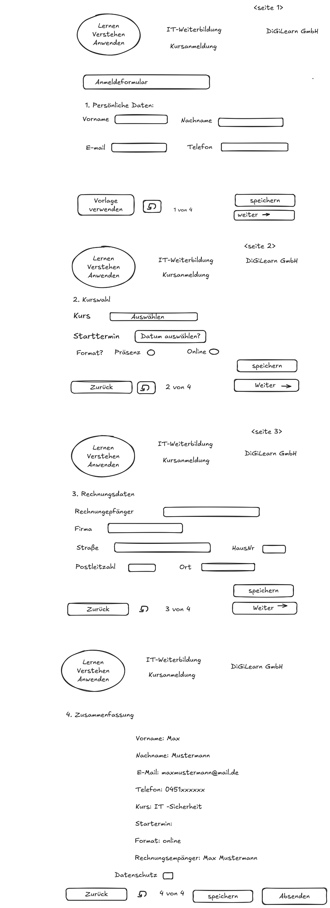

# MVU-Anmeldeformular

Vierseitiges Anmeldeformular für einen fiktiven Kursanbieter („DigiLearn GmbH“), gebaut nach dem Muster **Model-View-Update (MVU)**, in TypeScript ohne Framework.

Entstanden als Teamprojekt zu zweit in der Umschulung zum Fachinformatiker für Anwendungsentwicklung (bfw Lübeck). Der Schwerpunkt lag auf sauberer Architektur, Tests und Zusammenarbeit wie im echten Team: mit Branches, Pull Requests und gegenseitigen Reviews.



## Funktionen

- Vier Seiten mit Weiter, Zurück und einer Fortschrittsanzeige, über die man zu bereits besuchten Seiten springen kann
- Prüfung der Eingaben mit Fehlermeldung direkt am Feld
- Rückgängig über eine Historie aller Zustände
- Speichern als JSON, Laden mit Prüfung der Datei, Download beim Absenden
- Barrierefreiheit berücksichtigt

## Technik

| Bereich      | Eingesetzt                     |
| ------------ | ------------------------------ |
| Sprache      | TypeScript (ohne Framework)    |
| Architektur  | Model-View-Update              |
| Build & Dev  | Vite                           |
| Tests        | Vitest, 57 Tests für die Logik |
| Formatierung | Prettier                       |

## So funktioniert MVU hier

Die Anwendung hat genau einen Zustand, das **Model**. Ein Klick läuft so ab:

1. Die **View** schickt eine Message, z. B. `Weiter` oder `FeldGeaendert`.
2. **`update`** berechnet aus altem Model und Message ein neues Model, ohne Seiteneffekte.
3. Alles mit Außenwirkung (Datei herunterladen, Datei lesen) gibt `update` als **Effekt** zurück. `main.ts` führt ihn aus.
4. `main.ts` speichert das neue Model in der Historie und zeichnet die View neu.

Dadurch ist die gesamte Logik ohne Browser testbar.



Mehr dazu in der [Kurzdokumentation](docs/kurzdokumentation.md) und unter [Model und Messages](docs/model-und-messages.md).

## Starten

Voraussetzung: Node.js (LTS)

```bash
npm install
npm run dev
```

Dann im Browser `http://localhost:5173` öffnen.

| Befehl              | Wirkung                                 |
| ------------------- | --------------------------------------- |
| `npm test`          | Tests im Beobachtungsmodus              |
| `npm test -- --run` | Tests einmal ausführen                  |
| `npm run coverage`  | Testabdeckung anzeigen                  |
| `npm run build`     | Typen prüfen und Seite in `dist/` bauen |
| `npm run format`    | Code einheitlich formatieren            |

## Aufbau

| Datei                | Aufgabe                                            | Zuständig |
| -------------------- | -------------------------------------------------- | --------- |
| `src/types.ts`       | Model, Messages, Effekte – der gemeinsame Vertrag  | beide     |
| `src/main.ts`        | Runtime: Historie, Effekte ausführen, neu zeichnen | beide     |
| `src/update.ts`      | Neues Model aus altem Model und Message            | David     |
| `src/validierung.ts` | Prüfregeln je Seite                                | David     |
| `src/historie.ts`    | Historie und Rückgängig                            | David     |
| `src/datei.ts`       | JSON erzeugen und geladene Dateien prüfen          | David     |
| `src/view/`          | Oberfläche: alle Seiten, Fortschritt, Felder       | Danara    |
| `src/style.css`      | Aussehen                                           | Danara    |

## Zusammenarbeit im Team

- **Kein Commit direkt auf `main`.** Jede Änderung lief über einen eigenen Branch und einen Pull Request.
- **Jeder Pull Request wurde von der anderen Person geprüft**, erst danach wurde gemergt.
- Gemeinsame Dateien (`types.ts`, `main.ts`) wurden nur nach Absprache geändert.
- Tägliches kurzes Stand-up, Aufgaben über Issues und ein Projekt-Board.
- Ergebnis: 23 gemergte Pull Requests, 21 Commits von Danara, 25 von David.

Die vollständigen Regeln stehen in den [Teamregeln](docs/teamregeln.md). Die Entwurfsskizzen der Oberfläche liegen unter [Skizzen](docs/skizzen/).

## Team

- **Danara**: Oberfläche (View, CSS, Barrierefreiheit, Skizzen)
- **David**: Logik (Model, Update, Validierung, Historie, Tests), Repository und Board

Alle Daten im Projekt (z. B. „Max Mustermann“) sind erfunden.
